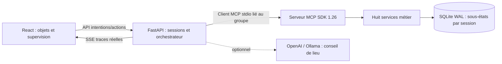

# Architecture et licences

`store.py` : transactions, snapshots, traces. `services.py` : huit services et actions sémantiques. `mcp_server.py` : SDK officiel ; `agent.py` : client stdio réel. `api.py` : tâches, pause/reset, supervision/export/frontend. `models.py` : choix facultatif de modèle. React : canvas SVG métier et séquences.

SQLite contient sessions (JSON/version/réservations), events (append-only) et snapshots (pile de restauration). Équipements, espaces, mémoire, calendrier, budget, documents, messages et workspace ont leurs sous-états propres par session. Dataset : `data/horizon.json`, entièrement fictif.

## Exécution

Préparation : Memory, Resources, Space, Calendar, Workspace et Budget. Une source retrouvée ne devient pas automatiquement active. Le modèle éventuel choisit uniquement un lieu admissible via `select_venue`.

Workspace crée une proposition et une empreinte métier. Validation humaine requise avant Workspace apply, Calendar schedule, Documents, Messaging et completion. Tous les appels ont arguments/résultats tracés. Aucun outil d'envoi externe ni de contrôle hôte.

Modifications humaines bloquées pendant mission ; animateur peut suspendre/annuler/reset. Un snapshot couvre l'exécution entière ; rollback si échec, génération protège du reset. Une seule instance Uvicorn : tâches en mémoire. SQLite WAL et transactions courtes prennent en charge cinq sous-processus. SSE reprend depuis curseur/Last-Event-ID ; heartbeat, reconnexion et polling 2 s complètent le suivi.

L'automatisation capture ressource/zone/horaires ; `resource_id` devient variable et chaque étape est rejouée, vérifiée et atomique. L'orchestrateur réutilise les paramètres finaux de recette pour les ressources compatibles avec la même zone. Canvas : sélection et zone deviennent paramètres de mission ; traits dessinés conservés sans interprétation IA.

## Références vérifiées le 4 octobre 2026

| Projet | Licence constatée | Décision |
|---|---|---|
| [tldraw](https://github.com/tldraw/tldraw) / [agent template](https://github.com/tldraw/tldraw/tree/main/templates/agent) | Licence personnalisée, développement autorisé, production exige licence/clé distincte. [Licence](https://github.com/tldraw/tldraw/blob/main/LICENSE.md). | Objets canvas comme surface d'action ; SVG natif maîtrisé pour MVP. Aucun code repris. |
| [UFO](https://github.com/microsoft/UFO) | [MIT](https://github.com/microsoft/UFO/blob/main/LICENSE). | Séparer orchestration/outils/observateur ; OS et contrôle applicatif trop larges. Aucun contrôle hôte. |
| [OpenAdapt](https://github.com/OpenAdaptAI/OpenAdapt) | [MIT](https://github.com/OpenAdaptAI/OpenAdapt/blob/main/LICENSE) dans le dépôt consulté. | Démonstration, programme admis, vérification des effets ; automatisation sémantique interne. Vérifier les licences des paquets transitoires avant intégration. |
| [Screenpipe](https://github.com/screenpipe/screenpipe) | [Licence commerciale actuelle](https://github.com/screenpipe/screenpipe/blob/main/LICENSE.md) ; évaluation organisationnelle 7 jours, usage commercial ultérieur payant. Anciennes versions MIT sous leur ancienne licence. | Mémoire temporelle/provenance ; aucun code/capture intégré. Consentement, filtrage, rétention et licence requis pour extension. |

README et licences consultés via API GitHub. Ne pas présumer ces références toutes permissives. Aucun code de ces quatre projets copié. Dépendances réelles pinnées dans `requirements.lock` / `frontend/package-lock.json` : React/MIT, Vite/MIT, FastAPI/MIT, SDK MCP/MIT, lucide/ISC, Segno/BSD-3 pour QR. La licence du code nouveau reste à décider par le propriétaire.

## Extensions

Adaptateur Screenpipe pourrait alimenter le schéma mémoire après activation/consentement, avec date/source. OpenAdapt pourrait exécuter hors application dans une couche séparée supervisée. Un agent LLM généraliste peut remplacer le planner, en conservant outils autorisés, empreintes et validation serveur. Ces extensions ne sont pas réalisées.
